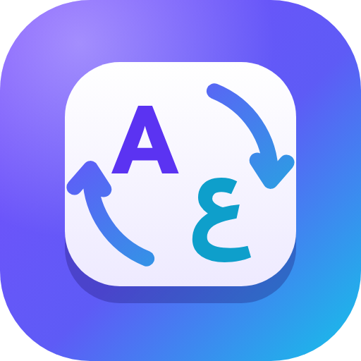

<div align="center">



# KeyFlip

**Typed in the wrong keyboard layout? Flip it — don’t retype it.**
**كتبت والكيبورد على اللغة الغلط؟ اقلب النص بدل ما تعيد كتابته.**

`;dt phg;` ⇄ `كيف حالك` · `ghbdtn` ⇄ `привет` · `[etre` ⇄ `être`

</div>

---

## English

KeyFlip is a Chrome extension (Manifest V3) that fixes text typed with the wrong keyboard layout, **in place**. It remaps every character to the character on the same physical key of your other layout, so you never delete and retype a line again.

### How to use it

| | Windows · Linux · ChromeOS | Mac |
|---|---|---|
| Select the text | `Ctrl` + `A` (or the mouse) | `⌘ Command` + `A` (or the mouse) |
| Flip it | `Ctrl` + `Q` | `⌃ Control` + `Q` |
| Undo | `Ctrl` + `Z` | `⌘ Command` + `Z` |

On a Mac KeyFlip uses **Control**, not Command, because `⌘ Command` + `Q` quits the browser.

You can also:
- **Right-click** the selection (or inside any text box) → **Fix keyboard layout**.
- Click the **floating button** that appears next to selected text in a text box.
- Press the shortcut again to flip back.
- With nothing selected, press the shortcut to flip the whole field (or only the last word, if you prefer).

### Features
- **Pick your exact layouts:** for example English (US QWERTY) ⇄ Arabic (101), or Arabic for Mac, Arabic QWERTY (Mac), Persian, Urdu, Hebrew, French AZERTY, German QWERTZ, Russian or Turkish. KeyFlip detects your OS and suggests the right Arabic layout. It can also detect the layout from a few keystrokes.
- **Smart لا handling:** on Windows the B key types “لا”, which is also G + H. KeyFlip uses an English word list to pick the right one and asks you only when it’s unsure.
- **Capital letters, hamza positions (أ إ آ), dead keys (ê, ü),** and presentation-form ligatures are all handled.
- **Works with real web apps:** text boxes, rich editors (contenteditable) and iframes. It keeps undo history and fires the events frameworks listen for.
- **Stats & achievements:** texts rescued, characters not retyped, minutes saved, streaks, plus a shareable card.
- **Arabic and English interface** (RTL), light and dark themes.
- **Private by design:** no network requests, no analytics. Text is processed on your device only.

### Develop

```bash
npm ci
npm run lint        # ESLint
npm run validate    # manifest, files, locales, store-policy checks
npm test            # unit tests (node:test)
npx playwright install chromium
npm run test:e2e    # loads the real extension into Chromium and drives it
KF_BROWSER=msedge npm run test:e2e   # same suite on Edge (also: chrome, brave, opera)
npm run package     # dist/keyflip-<version>.zip for the Chrome Web Store
```

Load it unpacked: `chrome://extensions` → Developer mode → **Load unpacked** → select this folder.

The keyboard tables in `src/core/layouts.data.js` are generated from Unicode CLDR data (`third_party/cldr`) by `npm run layouts`. Icons come from `assets/logo/*.svg` via `npm run icons`.

### Project layout

```
manifest.json            MV3 manifest (storage, contextMenus, scripting + site access)
_locales/                store name & summary in 8 languages
src/core/                conversion engine, layouts, dictionary, settings, stats, i18n
src/content/             in-page logic (shortcut, floating button, chooser, toast)
src/background/          service worker (install flow, right-click menu, stats)
src/ui/                  popup, settings page, welcome tour
tests/unit, tests/e2e    node:test and Playwright suites
store/                   Chrome Web Store kit: listings (8 languages), screenshots, tiles, videos
docs/                    GitHub Pages site: landing page + privacy policy
```

### Publish

- Step-by-step guide with copy-ready answers for every dashboard field: [`store/PUBLISHING-GUIDE.md`](store/PUBLISHING-GUIDE.md)
- Privacy policy: [`PRIVACY.md`](PRIVACY.md) — served at https://devehab.github.io/KeyFlip/privacy/ once GitHub Pages is enabled (Settings → Pages → Deploy from branch → `/docs`).
- Regenerate store graphics: `npm run store:assets`, `npm run store:video`, `npm run docs`.

### Tested on

Every push runs lint, store-policy validation, 53 unit tests and 44 end-to-end tests in real **Chromium, Google Chrome, Microsoft Edge, Brave and Opera** (GitHub Actions). A test that only passes on retry fails the build.

---

## العربية

**KeyFlip** إضافة لمتصفح كروم تصلح النص المكتوب بلغة الكيبورد الخطأ **في مكانه**. تحوّل كل حرف إلى الحرف المقابل له على نفس المفتاح في التخطيط الآخر، فلا تحتاج لمسح السطر وإعادة كتابته.

### طريقة الاستخدام

| | ويندوز · لينكس · كروم | ماك |
|---|---|---|
| ظلّل النص | `Ctrl` + `A` (أو بالماوس) | `⌘ Command` + `A` (أو بالماوس) |
| اقلبه | `Ctrl` + `Q` | `⌃ Control` + `Q` |
| تراجع | `Ctrl` + `Z` | `⌘ Command` + `Z` |

على الماك يستخدم KeyFlip زر **Control** وليس Command، لأن `⌘ Command` + `Q` يغلق المتصفح.

وتقدر كمان:
- تضغط **بزر الماوس الأيمن** على النص (أو داخل أي مربع كتابة) ← **صحّح لغة الكيبورد**.
- تضغط **الزر العائم** الذي يظهر بجانب النص المظلّل.
- تضغط الاختصار مرة ثانية لترجع النص كما كان.

### المزايا
- **اختيار التخطيط بدقة:** الإنجليزية (US) ⇄ العربية (101)، أو العربية على ماك، الفارسية، الأردية، العبرية، الفرنسية، الألمانية، الروسية، التركية. يكتشف KeyFlip نظام التشغيل ويقترح التخطيط المناسب.
- **معالجة ذكية لـ «لا»:** يحدد إذا كانت B أو G+H باستخدام قاموس، ويسألك فقط عند الشك.
- **الحروف الكبيرة والهمزات (أ إ آ)** والحروف المركّبة.
- **إحصائيات وإنجازات** مع بطاقة جاهزة للمشاركة.
- **واجهة عربية وإنجليزية** مع وضع فاتح وداكن.
- **خصوصية كاملة:** بدون إنترنت وبدون تحليلات، والنص يُعالَج على جهازك فقط.
